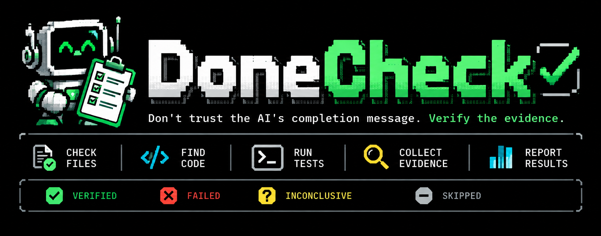
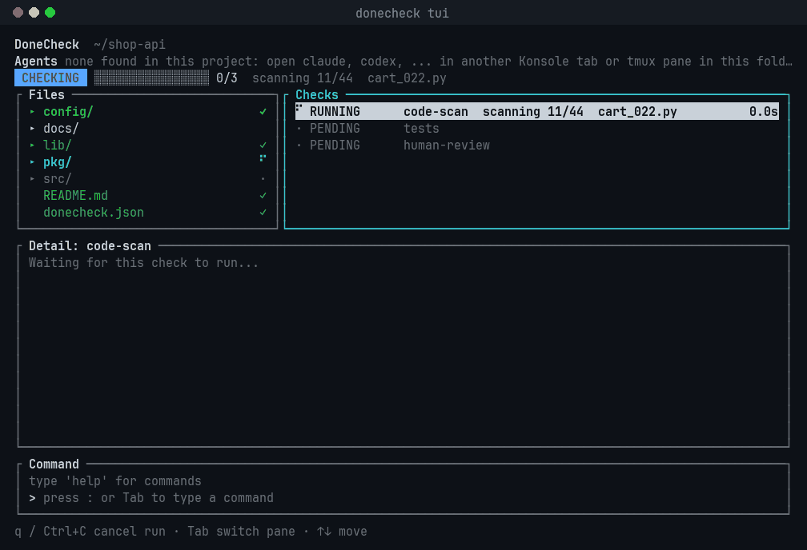

<p align="center"></p>

**Don't trust "it's done." Check.** DoneCheck inspects a project the way a skeptical
reviewer would and tells you, with evidence, whether the work holds up. It is built
for the moment an AI agent announces that everything is finished.

<p align="center"></p>
<p align="center"><sub>Recording of <code>donecheck tui --allow-commands</code></sub></p>

## What it catches

- **Leaked secrets.** Private keys and tokens (AWS, GitHub, Slack, JWT and more) sitting in the code.
- **Files that do not parse.** Syntax errors in Go, JSON, XML, Python, JavaScript, PHP, shell and Ruby, found before you run anything.
- **Copy-pasted code.** The same block of 20 or more lines in two places, shown with the code itself.
- **Dead code.** Go functions, types and constants that nothing uses.
- **Vulnerable dependencies.** Runs `govulncheck`, `npm audit` or `osv-scanner` and reports the advisory IDs.
- **Tests that did not run.** Runs your test command. If npm or pytest report that there is nothing to run, that is flagged, not passed.
- **What a person must still read.** Lists only the changed files a machine cannot vouch for (dependency manifests, CI, build scripts, tests that shrank), each with the reason.

## Results you can trust

Every check ends as `VERIFIED`, `FAILED`, `INCONCLUSIVE` or `SKIPPED`, with its reason
and evidence. Missing evidence is never a pass: a timeout, a scanner that is not
installed, or a file whose syntax could not be checked leaves the check unverified.
The project counts as done only when every mandatory check is `VERIFIED`, and the
exit code says so (`0` done, `1` something failed, `3` not fully verified), so it
works as a CI gate.

## Terminal UI

`donecheck tui` shows the project as a file tree and colours it by what the checks found.

- **Watch it work.** The scan maps every file first, then checks them one by one, with a real progress count.
- **See the problem.** Files turn red, folders show the worst status inside them, and the broken lines are marked in red in a syntax-coloured preview.
- **Jump to it.** `x` goes to the next problem at the exact line, and `e` opens it in your editor.
- **Stay in control.** It re-runs when files change and supports the mouse. Installing a scanner, allowing commands and sending to another program each ask for confirmation first.

## Quick start

You need Go 1.25 or newer; there are no prebuilt binaries.

```
git clone https://github.com/DemonPalace/DoneCheck
cd DoneCheck && ./install.sh          # builds and installs the donecheck command
cd path/to/your-project
donecheck init                        # adds .skill/, AGENTS.md and a starter donecheck.json
donecheck check --allow-commands      # exit code 0 only when every mandatory check is VERIFIED
donecheck tui --allow-commands        # the same checks in the terminal UI
```

`--allow-commands` lets checks run the commands in `donecheck.json` (your tests,
scanners, syntax checkers). Read that file first: DoneCheck runs what it says. Without
the flag those checks are skipped or unverified, never passed.

`install.sh` was tested on Linux only. For Windows there is `install.ps1`, which has not
been run yet; see [the reference](docs/reference.md#install) for the install options.

## Working with AI agents

`donecheck init` also writes short skills into `.skill/` and an `AGENTS.md` that tell a
coding agent to run `donecheck check` before saying it is done, and not to hide findings
to get a pass. That is an instruction, not enforcement; the check itself is what tells the truth.
If an agent is running in another Konsole tab or tmux pane in the same project, the UI can
send it a one-line fix request listing the failing checks, after you confirm.

## Documentation

- [Reference](docs/reference.md): commands, configuration, every check type and rule, ignoring findings, statuses and exit codes.
- [Terminal UI](docs/terminal-ui.md): keys, mouse, commands and the agent bar.
- [Security model and limitations](docs/security.md): what DoneCheck runs, what it never does, and what it cannot guarantee.

## Status

This repository ships no automated tests. Run `donecheck check --allow-commands` here to
check DoneCheck with DoneCheck (vet, a vulnerability scan and a code scan). The Windows
installer, `osv-scanner` support and sending to a live terminal tab have not been tried
on real systems.

## License

MIT, see [LICENSE](LICENSE).
